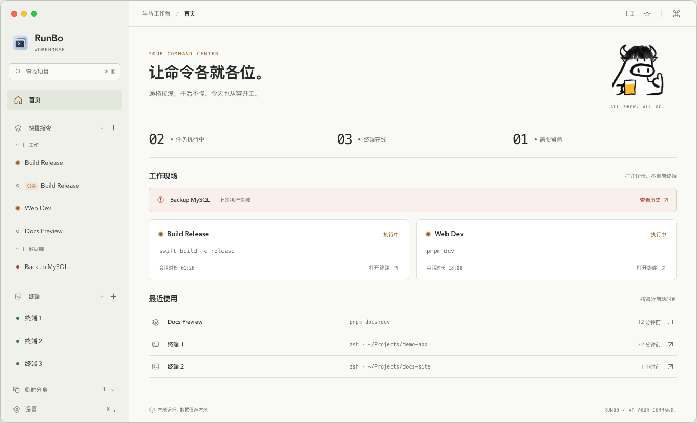
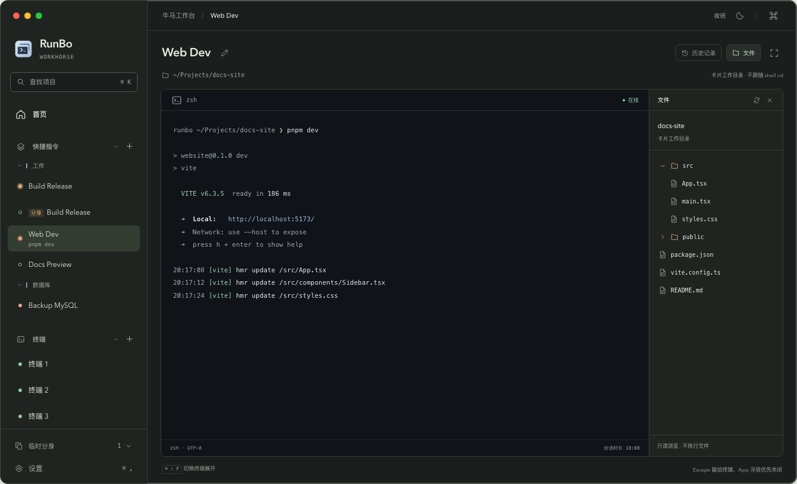
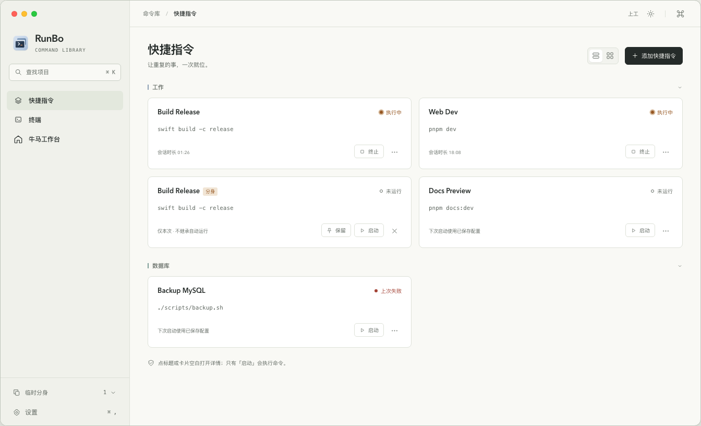

# RunBo

> 本地优先的 macOS 终端卡片工作台：把常用命令保存成卡片，一键启动成 App 内真正可交互的 shell，并把终端、会话历史回放和菜单栏入口集中在一个窗口里。

RunBo 不依赖云端服务。卡片、终端、会话元数据和历史都保存在本地；关闭窗口不会结束正在运行的终端，退出 App 时会统一收尾。



## 功能特性

- **快捷指令卡片**：保存名称、启动命令、shell、工作目录和环境变量；点击「启动」即可在 App 内运行，命令结束后 shell 仍可继续交互。
- **真实 PTY 终端**：基于 `forkpty` 的独立 shell 进程组，支持窗口尺寸同步、正常终止与强制终止；不是命令输出回放，也不是模拟终端。
- **终端菜单**：随时新建临时终端，查看连接状态；关闭主窗口后终端继续运行，可从菜单栏重新打开 App。
- **会话历史**：按卡片保留最近两次完整会话，支持只读回放；历史只记录终端实际可见的字节流，不记录原始按键。
- **卡片标签与分身**：标签用于分组；快捷指令可以创建一次性分身，复制启动配置但不复制历史或进程，也可保留为独立卡片。
- **牛马模式（Workhorse）**：在同一份数据上提供双栏工作台视图，左侧是快捷指令和终端列表，右侧常驻当前终端详情；可在标准卡片界面与牛马模式之间即时切换。
- **快速导航**：`⌘K` 按名称、已保存命令或标签查找项目；`↑` `↓` 选择，回车打开，不执行终端命令。
- **文件面板**：查看卡片工作目录，支持逐层浏览与只读预览；文本、图片、PDF 和 HTML 静态预览有明确的读取上限与安全限制，不修改源文件。
- **本地优先**：没有账号系统、云同步或远程主机管理；终端链接只在明确点击时交给系统浏览器或默认应用。

### 界面

| 终端详情 | 卡片模式 |
| --- | --- |
|  |  |

> 以上截图使用虚构数据，仅用于展示界面结构；实际界面以当前构建为准。

## 环境要求

- macOS 14 或更高。
- Swift 6 工具链（`swift --version`）。**不需要 Xcode**：项目用 SwiftPM 构建，由脚本组装 `.app`。
- 首次构建需要联网，以便 SwiftPM 拉取 [SwiftTerm](https://github.com/migueldeicaza/SwiftTerm) 1.20.0。

## 构建与运行

```bash
./scripts/build-app.sh            # release 构建，产出 build/RunBo.app
./scripts/build-app.sh debug      # debug 构建（开发时用）
open "build/RunBo.app"            # 启动
```

也可以直接用 SwiftPM 运行（不带 `.app` 外壳）：

```bash
swift run --product RunBo
```

底层构建脚本支持 `APP_OUTPUT_PATH=/absolute/path/RunBo.app` 指定输出位置，默认输出到 `build/RunBo.app`。

### App 内的重建与重启

在 App 的「Rebuild and Restart App」任务卡片中使用：

```bash
bash ./scripts/rebuild-and-restart.sh debug
```

脚本先在独立目录构建并校验签名，再交给 launchd 中的独立任务正常退出 RunBo；旧进程退出后才替换 `build/RunBo.app` 并启动新包。正常退出会结束全部终端，不跨重启续接进程。`bash scripts/rebuild-and-restart.sh debug --check` 只构建和预检，不退出、替换或启动 App。

## 验证

项目没有 Xcode，因此 XCTest / swift-testing 不可用；等价的自检 harness 是一个可执行目标：

```bash
swift run --scratch-path .build-checks runbo-checks            # 全部检查
swift run --scratch-path .build-checks runbo-checks retention. # 按名字过滤
bash scripts/verify-card-copies.sh                              # AppModel 分身流程（临时数据）
bash scripts/verify-file-browser.sh                             # 文件浏览与只读预览
```

更多脚本位于 `scripts/`，覆盖原生界面、真实 PTY、文件预览、侧栏、滚动条和重建/重启流程。部分脚本会创建隔离窗口、生成临时截图或需要用户允许后运行，执行前请阅读对应脚本头部说明。

## 数据与隐私

- 数据目录为 `~/Library/Application Support/RunBo`；目录权限 `0700`，数据库文件 `0600`。数据库使用版本化 SQLite。
- 卡片、终端、会话元数据和历史事件只保存在本地；不提供账号、云同步或远程主机管理。
- 历史只保存终端**实际可见**的字节流（含输出与尺寸变化），终端的原始按键不落盘。关闭回显的密码输入不会被额外记录；程序主动打印的敏感内容仍会进入历史，可在设置页清理。
- 快捷指令卡片与终端卡片都只保留**本次和上次两次**完整会话。已结束的普通临时终端在最后一次输入或输出满 24 小时后清理；一次性分身与已保留的终端启动卡不使用这条过期规则。
- 会话是 App 管理的独立 PTY + shell 进程组：关闭窗口不影响它们，退出 App 会先正常终止、必要时强制终止；崩溃遗留的会话在下次启动时只做收尾，不会续接。
- 文件预览只读：文本默认只读取前 1 MiB，图片 / PDF 上限 50 MiB，图片最多 4000 万像素；系统组件只接触权限受限的临时副本，关闭后释放，不修改原文件。

## 项目结构

```text
Sources/TerminalDeckKit/    核心模型、SQLite 存储、PTY、会话状态机与纯展示规则
Sources/TerminalDeck/       SwiftUI + AppKit 应用、菜单栏、终端与文件预览
Sources/TerminalDeckChecks/ 无 XCTest 依赖的自检 harness
scripts/                    构建、重建/重启与各项验证脚本
Resources/                  App 图标、菜单栏图标与 Info.plist
```

工程名、SwiftPM 目标与模块仍为 `TerminalDeck`，对外 App 名为 `RunBo`，Bundle ID 为 `com.runbo.app`；仓库目录名 `terminal-card` 是历史名称。

## 已知边界

- 第一版面向直接下载安装，不做 Mac App Store 沙盒适配，也不嵌入 Terminal.app / iTerm2 窗口。
- 退出 App 后不续接会话；不支持云同步、远程主机管理或终端自动重启。
- 「全屏」指终端面板放大到 App 的内容区，侧栏保留可见：不进入 macOS 系统全屏，也不覆盖侧栏。
- 终端外观只提供字号（12–24px 固定区间），不提供字体族、行距与主题选择；牛马模式更换的是工作台界面的布局与配色，不是终端自身的配色。
- 文件面板不提供编辑、保存、新建、重命名或删除；HTML 内嵌预览禁用页面 JavaScript，并限制网络、导航、表单、下载和嵌入文档。

## 许可证

源代码与文档采用 **MIT License**，见 [LICENSE](LICENSE)。

Copyright © 2026 Squirt1e.

界面图标、手绘牛插画、应用图标、README 截图与 RunBo 品牌素材**不在 MIT 授权范围内**，保留所有权利；未经许可请勿单独提取或再分发。详见 [ASSETS-LICENSE.md](ASSETS-LICENSE.md)。

第三方依赖按其自身许可证提供，见 [THIRD-PARTY-NOTICES.md](THIRD-PARTY-NOTICES.md)。

## 致谢

- 终端渲染基于 [SwiftTerm](https://github.com/migueldeicaza/SwiftTerm)，感谢其作者与贡献者。
- 界面图标、手绘插画与品牌素材的使用声明见 [ASSETS-LICENSE.md](ASSETS-LICENSE.md)。
